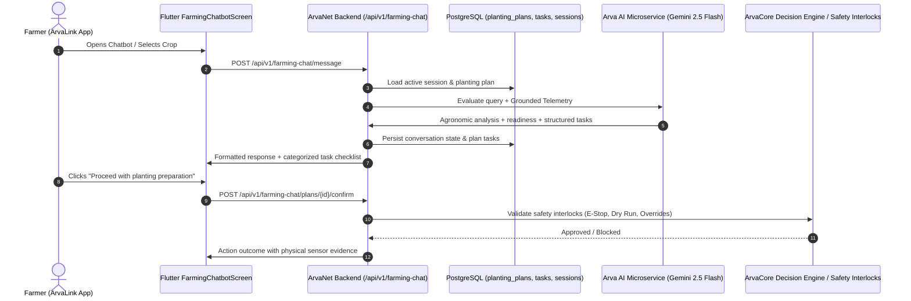

# Design: ArvaLink Farming AI Chatbot System

## Architecture Overview

## Agronomic Reference Standards
- **Lowland Rice (NSIC Rc 222)**: IRRI Alternate Wetting and Drying (AWD) protocol; safe drying to -15 cm, reflood +5 cm; continuous flooding during flowering (1-5 cm).
- **Hybrid Yellow Corn / Maize**: Soil moisture threshold 50-70% field capacity; waterlogged roots (>85% moisture for >48h) trigger aeration/drainage warnings.
- **Vegetable Crops (Eggplant, Tomato, Onion)**: Strict avoidance of saturated root zones; drip/furrow replenishment when moisture drops below 40%.

## Four-Category Task Separation Model
1. `SYSTEM_AUTOMATED`: Pre-irrigation soaking, sensor baseline calibration, scheduled water delivery (requires explicit confirmation).
2. `FARMER_MANUAL`: Land preparation, plowing/harrowing, leveling, seedbed soaking, bund repair, basal fertilizer application.
3. `EQUIPMENT_INFO`: Rotavator/tractor availability, water source salinity test, certified seed tag verification.
4. `SAFETY_BLOCKED`: Operations halted due to active Emergency Stop, pump dry-run risk, rain sensor trigger, or offline nodes.
